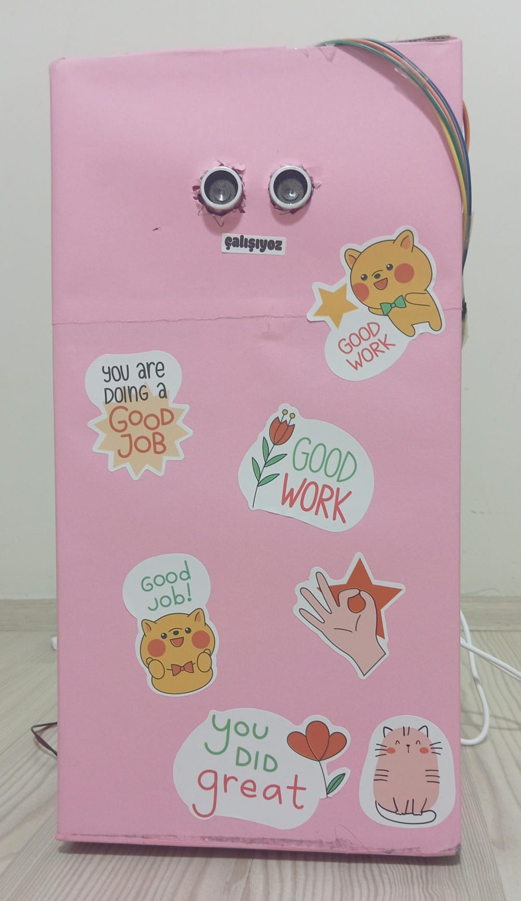
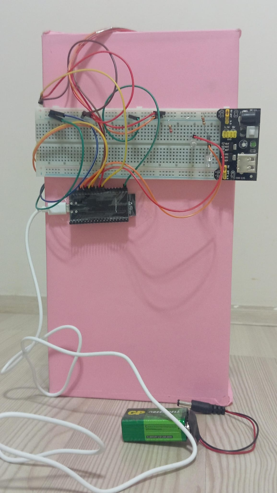
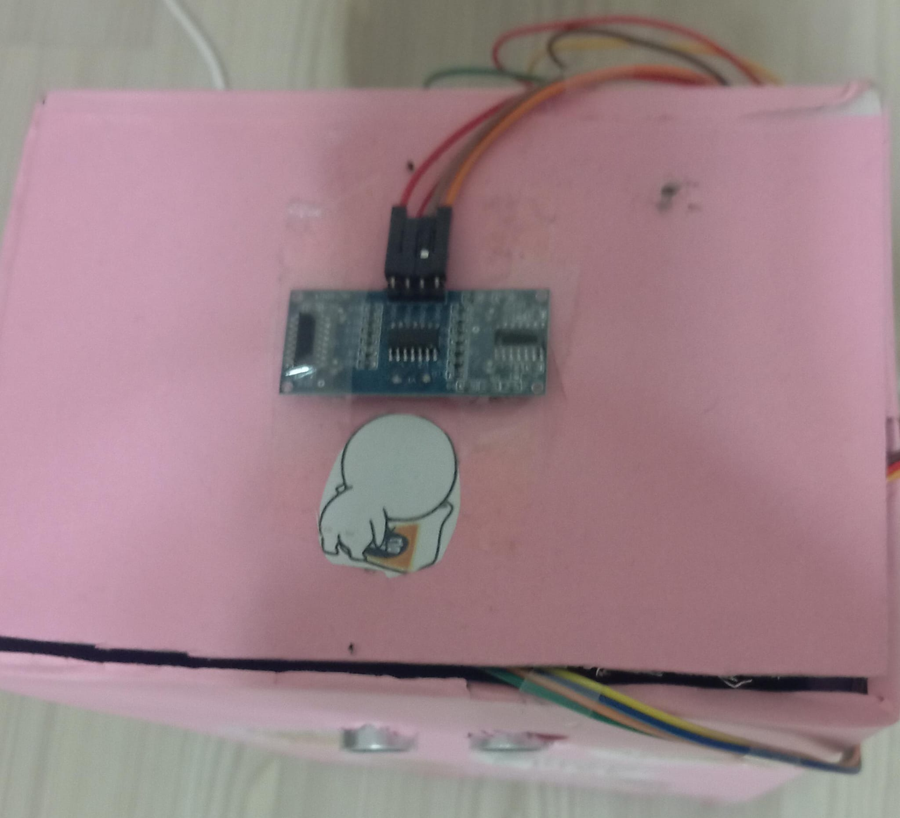

# IoT Tabanlı Akıllı Çöp Kutusu

ESP32 tabanlı bu proje, temassız kapak kontrolünü ve çöp kutusunun doluluk takibini bir araya getiren fiziksel bir prototiptir. İki ultrasonik sensörden alınan ölçümler ESP32 üzerinde işlenir; doluluk ve durum bilgileri Wi-Fi üzerinden MQTT kullanılarak ThingsBoard'a gönderilir.

Proje, fiziksel prototip üzerinde çalıştırılmış ve ThingsBoard'a veri gönderimi doğrulanmıştır.

## Fiziksel Prototip

  

| Arka görünüm — kontrol devresi ve bağlantılar | Üst görünüm — kapak ve sensör yerleşimi |
| --- | --- |
|  |  |

## Özellikler

- **Temassız kullanım:** Kutu dolu değilken dış sensör 5 cm veya daha yakın mesafede bir nesne algıladığında kapak açılır.
- **Otomatik kapanma:** Kapak açılma hareketinden sonra 4 saniye açık bekler ve kapanır.
- **Doluluk ölçümü:** İç sensörün ölçtüğü mesafeden, kodda tanımlı 30 cm kutu derinliğine göre yaklaşık doluluk yüzdesi hesaplanır.
- **Doluluk uyarısı:** Doluluk %80'e ulaştığında kırmızı LED yanar ve yeni kapak açma işlemleri engellenir. Kapak açık veya hareket hâlindeyse kapatma komutu verilir.
- **Durum göstergesi:** Doluluk eşiğinin altında yeşil LED yanar.
- **Buluta veri aktarımı:** MQTT bağlantısı varken yaklaşık 1 saniyelik aralıklarla ThingsBoard'a telemetri gönderilir.

Buradaki “kilitli” durumu yazılımsal olarak açılmanın engellenmesini ifade eder; ayrı bir mekanik kilit kontrol edilmez.

## Donanım ve Yazılım

| Bileşen / araç | Kullanım amacı |
| --- | --- |
| ESP32 geliştirme kartı | Sensör okuma, kapak kontrolü ve Wi-Fi bağlantısı |
| 2 adet HC-SR04 ultrasonik sensör | İç doluluk ölçümü ve dışarıdan el algılama |
| 360° sürekli dönüşlü servo motor | Kapak açma ve kapatma hareketleri |
| Kırmızı ve yeşil LED, dirençler | Durum göstergesi |
| Breadboard, jumper kablolar ve besleme düzeni | Prototip devre kurulumu |
| Arduino geliştirme ortamı ve ESP32 kart desteği | Kodu derleme ve karta yükleme |
| WiFi.h, PubSubClient.h, ESP32Servo.h | Ağ bağlantısı, MQTT ve servo kontrolü |
| ThingsBoard | Telemetri verilerini izleme |

## Kodda Kullanılan Pinler

Bu tablo sinyal pinlerinin yazılımdaki eşleşmesini gösterir; tam elektriksel bağlantı şeması değildir. Besleme ve sinyal seviyeleri, kullanılan donanımın teknik gereksinimlerine göre düzenlenmelidir.

| Bileşen | Sinyal | ESP32 GPIO |
| --- | --- | --- |
| İç sensör | TRIG | 18 |
| İç sensör | ECHO | 5 |
| Dış sensör | TRIG | 17 |
| Dış sensör | ECHO | 16 |
| Servo | PWM | 19 |
| Yeşil LED | Kontrol | 2 |
| Kırmızı LED | Kontrol | 4 |

## Çalıştırma

1. Arduino geliştirme ortamında ESP32 kart desteğini, **PubSubClient** ve **ESP32Servo** kütüphanelerini kurun. `WiFi.h`, ESP32 kart desteğiyle birlikte kullanılır.
2. `SmartTrashBin.ino` dosyasını açın. Arduino ortamı dosyayı aynı adlı bir klasöre taşımayı önerirse kabul edin; skeç yolu `SmartTrashBin/SmartTrashBin.ino` olur.
3. ThingsBoard'da bir cihaz oluşturun ve cihazın erişim token'ını alın.
4. Kodun aşağıdaki alanlarını kendi bağlantı bilgilerinize göre doldurun:
   - `WIFI_SSID`: Wi-Fi ağ adı
   - `WIFI_PASSWORD`: Wi-Fi şifresi
   - `TB_TOKEN`: ThingsBoard cihaz token'ı
   - `TB_SERVER` ve `TB_PORT`: Kullandığınız ThingsBoard ortamının MQTT adresi ve portu
5. Kutu derinliği ve servo hareket sürelerini kendi fiziksel düzeneğinize göre ayarlayın.
6. Uygun ESP32 kartını ve portunu seçerek kodu yükleyin. Seri monitörü **115200 baud** ile açın.
7. Cihaz bağlantısını ve gelen telemetri alanlarını ThingsBoard üzerinden kontrol edin.

Depodaki bağlantı bilgileri yer tutucudur. Kendi Wi-Fi şifrenizi ve cihaz token'ınızı herkese açık depoya yüklemeyin.

## ThingsBoard Telemetrisi

Yayın konusu: `v1/devices/me/telemetry`

| Alan | Açıklama |
| --- | --- |
| `icMesafe` | İç sensör ölçümü, cm; geçersiz ölçümler kodda kutu derinliğiyle değiştirilir |
| `dolulukOrani` | İç mesafeden hesaplanan yaklaşık doluluk yüzdesi |
| `disMesafe` | Dış sensör ölçümü, cm; geçersiz ölçümlerde 400 kullanılır |
| `kilitli` | Doluluk eşiğine ulaşıldığında `true`, aksi durumda `false` |

## Prototipin Çalışma Notları

- Sürekli dönüşlü servo, konum geri bildirimi yerine süreyle kontrol edilir. Açma ve kapatma hareketleri kodda 800 ms olarak ayarlanmıştır; mekanizmaya göre kalibrasyon gerekir.
- Normal kapak hareketleri bir durum makinesiyle yönetilir. Bununla birlikte kodda sensör beklemeleri ve `delay()` çağrıları bulunduğundan sistem tamamen bloklamasız değildir.
- Wi-Fi bağlıyken MQTT bağlantısı kesilirse 10 saniyelik aralıklarla yeniden bağlanma denenir. Bağlantı kurulma süresi döngüyü etkileyebilir.
- İç sensörün geçersiz ölçümü boş kutu olarak değerlendirilir; mevcut sürüm ayrı bir sensör arıza durumu üretmez.
- Mevcut sürüm MQTT için TLS kullanmayan `WiFiClient` ve 1883 portunu kullanır.
- Fotoğraflar fiziksel prototipi gösterir. Bu depo, bir prototip uygulamasını belgeler; uzun süreli saha testi veya ölçüm doğruluğu raporu içermez.

## Proje Dosyaları

- `SmartTrashBin.ino`: ESP32 kaynak kodu.
- `images/`: Fiziksel prototip fotoğrafları.
- Proje klasöründeki sunum PDF'i, afiş ve poster: Projeye ait ek tanıtım materyalleri.
